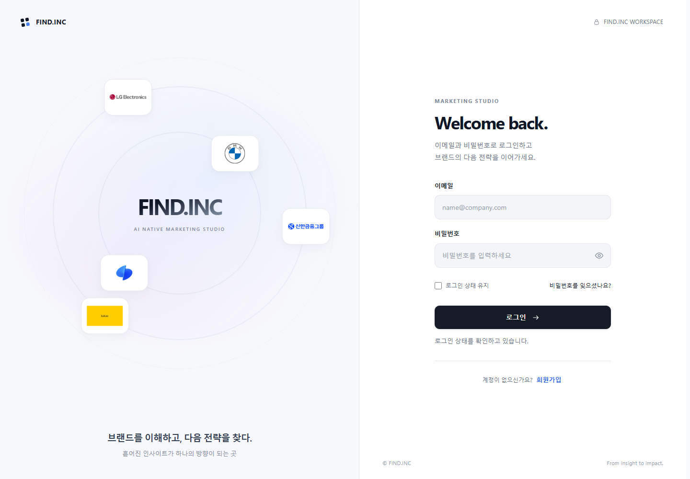

# FIND.INC Marketing Studio

- 주식회사 파인드의 마케팅 작업 공간
- 브랜드와 상품 조사, 콘텐츠 관리, 채널 성과 조회
- 웹 대시보드와 Flutter 앱에서 프로젝트 자료 활용

[웹 대시보드](https://find-inc.web.app/login.html) | [Flutter 앱 실행 안내](apps/dashboard/README.md)

## 프로젝트 소개

- 운영 주체: 마케팅 에이전시 주식회사 파인드
- 목적: 조사 자료와 제작물, 채널 운영 기록을 한 프로젝트에서 관리
- 작업 방식: 사람이 목표와 최종 결정을 정하고 AI 에이전트가 프로젝트 규칙과 스킬에 따라 작업
- 자료 관리: 브랜드와 상품별 폴더에 조사 근거와 산출물 보관
- 사용 화면: 웹 대시보드에서 자료와 작업 상태 확인, Flutter 앱에서 모바일 기능 사용
- 재무 영역: `04-finance/` 폴더만 준비된 상태

### 업무 흐름

| 단계 | 작업 | 저장 위치 |
| --- | --- | --- |
| 전략 | 브랜드와 상품 조사, 경쟁 분석, 고객 조사, 마케팅 브리프 작성 | `01-strategy/` |
| 콘텐츠 | 카피, 이미지, 영상, 랜딩 페이지 제작 | `02-contents/`, `sites/` |
| 운영 | 채널별 콘텐츠 발행과 운영 자료 관리 | `03-operation/` |
| 성과 확인 | 채널 지표 조회와 다음 작업 판단 | Operation 메뉴 |

### 구성 요소와 역할

- 프로젝트 문서: 조사 근거, 작업 규칙, 결정 내용을 파일로 보관
- 스킬: 브랜드 조사, 콘텐츠 제작, 성과 수집 등 반복 작업의 수행 절차 정의
- 웹 대시보드: 조사 보고서 탐색, Drive 콘텐츠 조회, 성과 확인, 원격 작업 요청
- Flutter 앱: 기존 대시보드의 주요 기능을 모바일 화면으로 제공
- Happier: 실행 PC의 Codex와 연결해 앱과 웹에서 요청한 스킬 실행
- 외부 서비스: Firebase 로그인과 Firestore 회의 기록, Google Drive 파일 조회, Supabase 성과 데이터 조회

### 작업 규칙

- 공통 작업 지침: [AGENTS.md](AGENTS.md)
- 회사 정보: [회사 소개](docs/company/company.md)
- 부서별 자료와 채널별 연동 코드를 지정된 폴더에서 관리
- 중요한 결정은 [결정 기록](docs/decisions/)에 보관
- 콘텐츠 원본은 로컬과 Google Drive에서 관리하고 소스 코드와 운영 문서는 Git으로 관리

## 화면

- 로그인: Firebase Hosting의 실제 화면
- 대시보드: 로컬 HTTP 서버와 테스트 인증으로 재현한 화면
- 가상 오피스: 샘플 세션으로 구성한 시뮬레이션
- 모바일: 390px 너비의 웹 화면

### 로그인

- Firebase 이메일과 비밀번호 로그인
- 회원가입, 로그인 상태 유지, 비밀번호 재설정



### Strategy

- 브랜드와 상품별 조사 자료 조회
- 경쟁 분석, 고객 조사, 마케팅 브리프 확인


### Operation

- YouTube, Instagram, Search Console 성과 조회
- 채널별 지표와 기간 필터
- 첨부 화면: 데이터가 없는 상태


### 가상 오피스

- 에이전트 역할과 세션 상태 표시
- 샘플 데이터로 작업 진행 상황 재현


### 모바일 웹

- 모바일 화면에 맞춘 탐색 메뉴와 보고서 배치
- 첨부 자료는 Flutter 네이티브 앱이 아닌 모바일 웹 화면


## 기능

| 기능 | 웹 대시보드 | Flutter 앱 |
| --- | --- | --- |
| 로그인 | Firebase 이메일과 비밀번호 | 같은 Firebase 프로젝트 사용 |
| Strategy | 브랜드, 상품, 경쟁, 고객 조사와 브리프 | 앱에 포함한 보고서와 이미지 조회 |
| Contents | Google Drive 폴더와 파일 조회 | Google OAuth 연결 후 검색과 미리보기 |
| Operation | 채널 성과 조회 | Supabase의 `channel_metrics` 직접 조회 |
| 스킬 실행 | Happier 연결 후 원격 Codex 실행 | 암호화 연결 확인 후 실행과 결과 조회 |
| 가상 오피스와 AI 회의 | 세션 표시와 회의 화면 | 미구현 |
| 내 회의 기록 | AI 회의실에서 최신순 조회 | 하단 `회의 기록`에서 최신순 조회 |

### AI 회의 기록

- 웹에서 `AI 회의 열기`로 회의를 시작합니다. 팀장이 정리를 마치면 주제, 참여 부서, 요약, 시작·종료 시각과 사용자 UID를 Firestore의 `meetings`에 저장합니다.
- 웹 회의실의 `내 회의 기록`과 Flutter 앱 하단의 `회의 기록`에서 같은 계정의 회의를 최신순으로 볼 수 있습니다.
- Firestore 규칙은 로그인한 사용자가 자기 기록만 생성하고 조회하도록 제한합니다. Git 회의록은 기존대로 `docs/meetings/`에 저장합니다.
[Firestore 규칙](firestore.rules) · [조회 인덱스](firestore.indexes.json)

### Happier 연결

- Happier: 실행 PC의 Codex 세션을 원격으로 연결하는 서비스
- 실행 PC와 폴더: 최근 사용 기록으로 자동 선택, 이후 변경 가능

1. 실행 PC와 같은 계정으로 로그인
2. Accept Connection 선택
3. 앱으로 돌아와 연결 확인

## 프로젝트 구성

| 폴더 | 내용 |
| --- | --- |
| [01-strategy](01-strategy/) | 브랜드와 상품 조사, 경쟁 분석, 고객 조사, 마케팅 전략 |
| `02-contents/` | 콘텐츠 원본과 에셋 보관, Git 제외 |
| [03-operation](03-operation/) | 채널 연동 코드와 운영 자료 |
| [04-finance](04-finance/) | 재무 자료용 폴더, 현재 비어 있음 |
| [dashboard](dashboard/) | 웹 대시보드와 자동화 테스트 |
| [apps/dashboard](apps/dashboard/) | Android, iOS, Web용 Flutter 앱 |
| [.agents/skills](.agents/skills/) | 프로젝트 스킬 |
| [docs](docs/) | 회사 정보, 작업 규칙, 결정 기록 |

## 실행

### 웹

- 실행 위치: 저장소 루트
- 접속 주소: <http://127.0.0.1:8000/login.html>
- 필요 환경: Python, 인터넷 연결, Firebase 등록 계정
- 상세 안내: [로그인 설정](dashboard/AUTH.md)

```sh
python -m http.server 8000 --bind 127.0.0.1 --directory dashboard
```

### Flutter 앱

- 실행 방법: VS Code에서 저장소 루트를 열고 F5
- 기본 대상: Android 에뮬레이터
- 필요 환경: Flutter SDK, Android SDK
- iOS 실행 환경: macOS, Xcode
- 상세 안내: [앱 README](apps/dashboard/README.md)

```sh
cd apps/dashboard
flutter pub get
```

## 서비스 연결

| 서비스 | 연결 조건 |
| --- | --- |
| Firebase Auth | 등록된 이메일과 비밀번호 |
| Cloud Firestore | 같은 Firebase 계정으로 본인 회의 기록 조회 |
| Google Drive | 폴더 접근 권한이 있는 Google 계정으로 별도 승인 |
| Supabase | 공개 읽기를 허용한 성과 테이블 조회 |
| Happier | 온라인 상태의 실행 PC와 유효한 Codex 로그인 |

- Contents: Google Drive 읽기 권한으로 폴더와 파일 조회
- Drive 설정: [연결 안내](dashboard/DRIVE.md)
- 웹 보고서 보호 범위: 로그인 화면 접근 제어, HTML에 포함된 보고서는 원본 추출 가능
- 서버에서 비공개 자료 제공 시 사용자 권한 검사 필요
- Git 제외 대상: 인증 토큰, 비밀키, `.env`, `.private/`, 빌드 파일

## 화면 자료 재현

- 실행 도구: 로컬 HTTP 서버, Playwright
- 인증 데이터: 기존 테스트 응답과 `.invalid` 테스트 계정
- 캡처 저장 위치: `docs/media/`
- 실행 조건과 검증 범위: [캡처 기록](docs/media/capture-report.json)
- 재현 코드: [캡처 스크립트](dashboard/tests/readme-capture.cjs)
- 검증 기준: [대시보드 검증 가이드](docs/guides/dashboard-verification.md)

```sh
cd dashboard/tests
npm ci
npx playwright install chromium
node readme-capture.cjs
```
