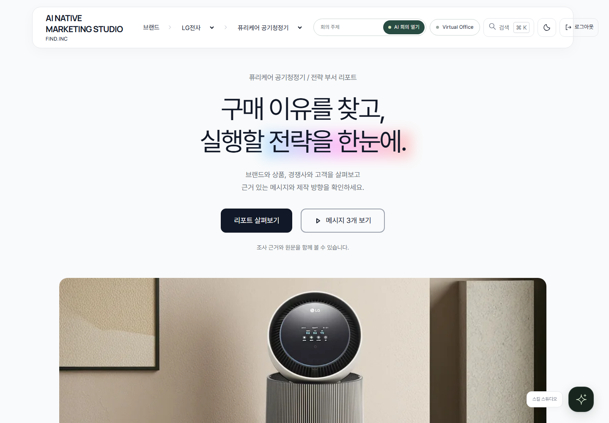
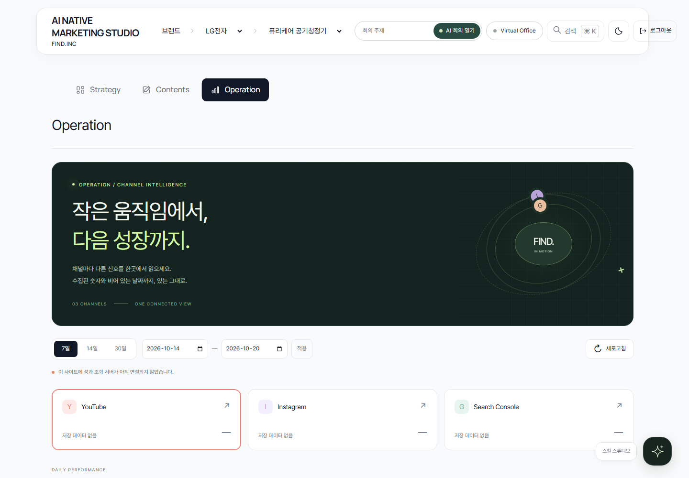
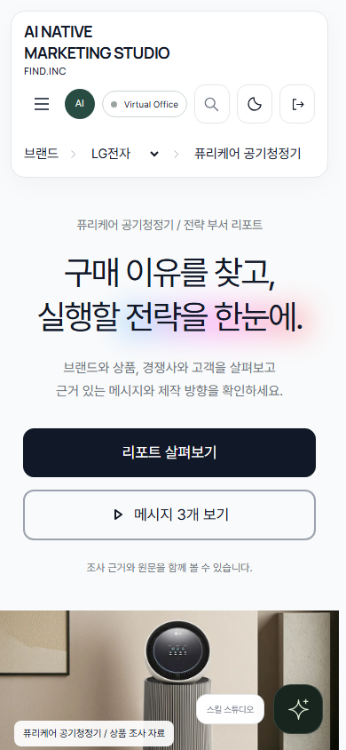

# FIND.INC Marketing Studio

주식회사 파인드의 마케팅 작업 공간입니다. 브랜드와 상품을 조사하고 콘텐츠를 관리하며 채널 성과를 확인합니다. 웹 대시보드와 Flutter 앱에서 같은 프로젝트 자료를 사용합니다.

[웹 대시보드 열기](https://find-inc.web.app/login.html) | [Flutter 앱 실행 안내](apps/dashboard/README.md)

## 화면

실제 HTML과 JavaScript를 HTTP 서버에서 실행한 화면
### 로그인

Firebase Hosting에서 제공하는 로그인 화면을 캡처했습니다. 실제 계정으로 로그인하지 않았으며 인증서 날짜 오류 때문에 캡처용 브라우저에서만 인증서 검사를 생략했습니다.


### Strategy

브랜드와 상품을 선택하면 조사 자료와 마케팅 브리프를 읽을 수 있습니다. 저장소의 보고서 데이터를 그대로 사용하고 Firebase 인증 응답만 테스트 데이터로 바꿨습니다.



### Operation

채널 성과를 조회하는 화면입니다. 이번 로컬 서버에는 성과 조회 API가 연결되지 않아 연결 안내와 빈 상태를 캡처했습니다. 지표 응답을 임의로 채우지 않았습니다.



### 가상 오피스

기존 미리보기 페이지에서 세션 상태를 재현했습니다. 캐릭터와 진행 상황은 시뮬레이션이며 실제 작업 중인 에이전트를 캡처한 자료는 아닙니다.


### 모바일 웹

390px 화면에서 실행한 웹 대시보드입니다. Flutter 앱의 네이티브 화면과는 다릅니다.



각 화면의 실행 환경과 데이터 구분은 [캡처 기록](docs/media/capture-report.json)에 남겼습니다. 이번 자료에는 Flutter 앱의 새 빌드나 네이티브 화면 캡처를 포함하지 않았습니다.

## 기능

| 기능 | 웹 대시보드 | Flutter 앱 |
| --- | --- | --- |
| 로그인 | Firebase 이메일과 비밀번호 | 같은 Firebase 프로젝트의 이메일과 비밀번호 |
| Strategy | 브랜드, 상품, 경쟁, 고객 조사와 브리프 | 앱에 포함한 보고서와 이미지 조회 |
| Contents | Google Drive 폴더와 파일 조회 | Google OAuth 연결 후 검색과 미리보기 |
| Operation | 채널 성과 조회 | Supabase의 `channel_metrics` 직접 조회 |
| 스킬 실행 | Happier 연결 후 원격 Codex 실행 | 암호화 연결 확인 후 원격 실행과 결과 조회 |
| 가상 오피스와 AI 회의 | 세션 표시와 회의 화면 | 미구현 |

Happier는 실행 PC의 Codex 세션을 원격으로 연결하는 서비스입니다. Flutter에서는 같은 계정으로 로그인한 뒤 Accept Connection을 누르고 앱으로 돌아오면 연결을 확인합니다. 실행 PC와 폴더는 최근 사용 기록으로 선택하며 나중에 바꿀 수 있습니다.

## 프로젝트 구성

| 폴더 | 내용 |
| --- | --- |
| [01-strategy](01-strategy/) | 브랜드와 상품 조사, 경쟁 분석, 고객 조사, 마케팅 전략 |
| `02-contents/` | 콘텐츠 원본과 에셋을 보관하는 로컬 폴더이며 Git에는 포함하지 않음 |
| [03-operation](03-operation/) | 채널 연동 코드와 운영 자료 |
| [04-finance](04-finance/) | 재무 자료를 위한 빈 폴더 |
| [dashboard](dashboard/) | 웹 대시보드와 자동화 테스트 |
| [apps/dashboard](apps/dashboard/) | Android, iOS, Web용 Flutter 앱 |
| [.agents/skills](.agents/skills/) | 프로젝트에서 사용하는 스킬 |
| [docs](docs/) | 회사 정보, 작업 규칙과 결정 기록 |

## 실행

### 웹

저장소 루트에서 실행합니다.

```sh
python -m http.server 8000 --bind 127.0.0.1 --directory dashboard
```

브라우저에서 <http://127.0.0.1:8000/login.html>을 엽니다. 실제 로그인에는 Firebase에 등록된 계정과 인터넷 연결이 필요합니다. 계정과 인증 동작은 [로그인 안내](dashboard/AUTH.md)를 참고해 주세요.

### Flutter 앱

```sh
cd apps/dashboard
flutter pub get
```

저장소 루트를 VS Code에서 열고 F5를 누르면 Android 에뮬레이터에서 앱을 실행합니다. Android SDK와 Flutter SDK가 필요하며 iOS 실행에는 macOS와 Xcode가 필요합니다. 플랫폼별 설정은 [앱 README](apps/dashboard/README.md)에 있습니다.

## 서비스 연결과 자료 보호

Google Drive는 폴더 접근 권한이 있는 Google 계정으로 별도 승인합니다. 앱의 Contents는 읽기 권한으로 폴더와 파일을 조회합니다. 자세한 설정은 [Drive 안내](dashboard/DRIVE.md)를 참고해 주세요.

앱의 Operation은 공개 읽기를 허용한 Supabase 성과 테이블을 조회합니다. Happier에서 스킬을 실행하려면 실행 PC가 온라인 상태여야 하고 해당 PC의 Codex 로그인도 유효해야 합니다. 화면이 열린 사실만으로 실제 서비스 연결이나 작업 완료를 판단하지 않습니다.

웹 로그인은 화면 접근을 제어합니다. 보고서가 HTML에 포함되어 있어 로그인만으로 보고서 원본까지 비공개로 보호하지는 못합니다. 자료를 비공개로 제공하려면 서버에서 사용자 권한을 검사하는 구성이 필요합니다.

인증 토큰과 비밀키, `.env`, `.private/`, 빌드 파일은 Git에서 제외합니다. Firebase의 공개 앱 설정과 관리자 인증 정보는 구분해 관리합니다.

## 화면 자료 재현

```sh
cd dashboard/tests
npm ci
npx playwright install chromium
node readme-capture.cjs
```

캡처 스크립트는 로컬 HTTP 서버와 화면을 띄우지 않는 Playwright 브라우저를 사용합니다. 공개 로그인 페이지를 확인한 뒤 기존 인증 테스트 응답으로 대시보드 화면을 재현하고 결과를 `docs/media/`에 저장합니다. 테스트 계정은 `.invalid` 도메인을 사용하며 실제 사용자 생성이나 메일 발송은 하지 않습니다.

[캡처 스크립트](dashboard/tests/readme-capture.cjs)와 [대시보드 검증 가이드](docs/guides/dashboard-verification.md)에서 실행 방식과 검증 범위를 확인할 수 있습니다.

